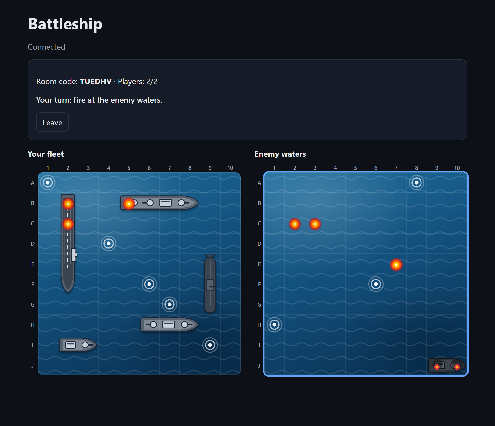
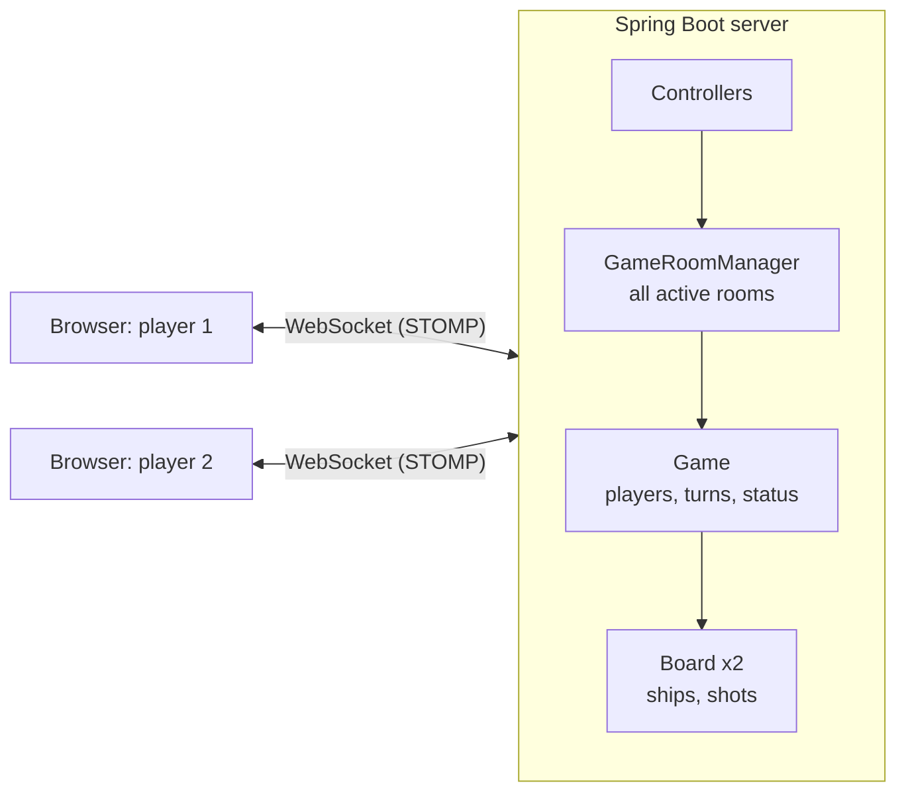
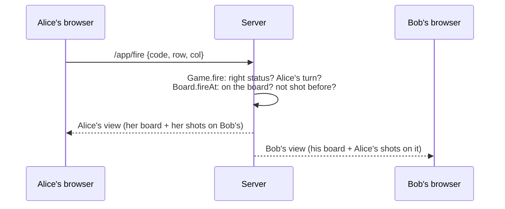

# Online Battleship

A real-time multiplayer Battleship game played in the browser. Create a room, share the 6-letter code with a friend, place your fleet, and take turns firing. Both screens update live.

**▶ Play it: http://18.219.114.254**



Built solo in Java with Spring Boot and WebSockets, covered by 118 automated tests, and deployed on AWS EC2.

---

## Features

- **Rooms with codes**: one player creates a room, the other joins with its code (case-insensitive)
- **Ship placement** with a live preview, rotation (button or `R`), and server-side checks for edges and overlaps
- **Turn-based firing**: hit, miss and sunk appear instantly on both screens
- **Server-side rules**: wrong turn, repeated shots, off-board shots and moves from outside the game are all refused
- **Win detection**, then **rematch** (both players must agree) or **leave** (the opponent is told and returned to the menu; closing the tab counts as leaving)
- **Hidden boards**: a player's browser never receives the opponent's ship positions

---

## How it works



Each browser keeps one WebSocket open. Players **send** moves to `/app/...` destinations, and the server **pushes** updates to each player's private `/user/queue/...` destinations.



### Design decisions

**The server is the only source of truth (anti-cheat).**
All rules live in the server's game logic, and the browser only displays what it's told. After every move, the server builds a **separate view for each player**: your own board shows your ships, but the opponent's board only shows your shots and what they hit. An opponent's ship is only revealed once it's sunk. The opponent's ship positions are never in the data sent to your browser, so there's nothing to find in the developer tools. Tests check every message of a complete networked game for leaks.

**The server decides who you are.**
Each WebSocket connection gets a random player ID during the handshake. Browsers never send their own ID, so one player can't act as the other.

**Thread safety.**
Each player is handled on their own thread, so two moves can arrive at the same moment.
- Rooms are stored in a `ConcurrentHashMap`, and new room codes use `putIfAbsent`, so two rooms can never share a code.
- Every change to a game (joining, placing, firing, rematching, leaving) is `synchronized` on that game, so a double-clicked shot can't give a player two turns. Joins to *different* rooms don't wait for each other.
- A move and the views it sends happen under the same lock, and Spring is configured to keep each player's messages in order, so a browser never shows an older board after a newer one.
- Tests start 100 threads joining one room (and 50 shots fired at once) and check that exactly one succeeds. With `synchronized` removed, those tests fail on most runs. Races depend on timing, so they don't show up every time, which is why the tests use many threads starting together.

**Full snapshots after every move.**
Each player receives their whole view, not just what changed. It keeps the browser simple (it just redraws) and self-correcting (a late message is fixed by the next one), and two 10×10 grids are tiny.

**In-memory state, no database.**
Games are short-lived, so they live in memory. The trade-off: restarting the server ends games in progress.

---

## Tech stack

| Part | Choice |
|---|---|
| Language | Java 21 |
| Framework | Spring Boot 4 (Spring Web, WebSocket + STOMP) |
| Front end | Plain HTML, CSS and JavaScript, ships drawn as SVG, [STOMP.js](https://github.com/stomp-js/stompjs) |
| Tests | JUnit 5, including integration tests with real WebSocket clients |
| Build | Maven (wrapper included) |
| Hosting | AWS EC2 (Amazon Linux 2023, t3.micro), systemd, Elastic IP |

---

## Testing

**118 tests**, run with `./mvnw test`:

| Kind | What they cover |
|---|---|
| **Unit tests** (93) | Ship placement and edges, shooting, sinking, turns, winning, rematch, the per-player views, and concurrency races |
| **Integration tests** (24) | The whole app started on a random port, with real WebSocket clients playing full games: joining, errors, anti-cheat checks on every message, rematch, leaving and closed tabs |

To check the tests catch real bugs, bugs were planted on purpose (an off-by-one on the board edge, a missing `synchronized`, sending the opponent's real board), and the tests were confirmed to fail before restoring the code.

---

## Running it locally

Requires **Java 21** or newer.

```bash
./mvnw spring-boot:run
```

On Windows, use `mvnw.cmd spring-boot:run`. Then open **http://localhost:8080** in two browser windows (or a normal and a private window) and play against yourself.

To build the runnable jar (this also runs all the tests):

```bash
./mvnw clean package
java -jar target/battleship-0.0.1-SNAPSHOT.jar
```

---

## Deployment

The game runs on an **AWS EC2** t3.micro with Amazon Linux 2023 and Amazon Corretto 21, at a permanent Elastic IP.

- The jar runs as a **systemd** service ([`deploy/battleship.service`](deploy/battleship.service)): it restarts automatically after a crash and starts at boot.
- It runs as a dedicated **unprivileged, no-login user**, with only the capability needed to listen on port 80, rather than as root.
- The firewall allows **HTTP (80)** from anywhere and **SSH (22)** from a single IP only, with key-based login.
- Updates go out with one script, [`deploy/deploy.ps1`](deploy/deploy.ps1): build and test (it stops if any test fails), copy the jar, restart the service.

---

## Project structure

```
src/main/java/com/adam/battleship/
├── model/        Board, Ship, ShipType, Coordinate, CellView, ShipLayout, …
├── game/         Game (rules, turns, rematch), GameRoomManager (all rooms), PlayerView
├── controller/   WebSocket message handlers, private updates, leaving, error handling
├── dto/          The messages sent between browser and server
└── config/       WebSocket/STOMP setup, player IDs at the handshake
src/main/resources/static/   index.html, app.js, ships.js, style.css
src/test/java/...            unit and integration tests
deploy/                      systemd service, server setup and deploy scripts
```

---

## How I used AI

I built this with [Claude Code](https://claude.com/claude-code) as a development tool, with clear rules:

- **I wrote the core game logic** myself: the board, ships, shooting, turns, win detection, rooms, rematch, and the per-player views that hide the opponent's ships.
- **AI helped with** project setup, the WebSocket controllers, the front end and its visuals, deployment scripts, writing tests, and reviewing my code.
- **Every AI change was tested**, and tests were checked by deliberately breaking the code. That process caught real problems, including a race condition in an early design and gaps in AI-written tests, which were then fixed.

---

## What I'd add next

- HTTPS with a domain name
- Continuous deployment from GitHub Actions on every push
- Reconnecting to your game after a page refresh
- An AI opponent (hunt-and-target) for single-player games
- Shared game state (for example Redis) so a deploy doesn't end games, and several servers behind a load balancer

---

Made by [Adam Benikhlef](https://github.com/AdamB-Git7).
